# 贵州麻将（Electron 桌面版）：经典 · 贵阳捉鸡 / 幺筒麻将 · 联机

一个能真正坐下来打的贵州麻将：108 张牌、碰 / 杠 / 胡、报听、抢杠胡、热炮、一炮多响。单机、联机都行。

进入游戏先是**游戏大厅**：看自己的资料与战绩、选玩法开桌。两种玩法各算各的账：

| 玩法 | 一句话 |
| --- | --- |
| **经典 · 贵阳捉鸡** | 四类鸡（幺鸡 / 乌骨鸡 / 翻牌鸡 / 金鸡）、冲锋鸡、责任鸡、包鸡，报听锁牌，抢杠热炮 |
| **幺筒麻将** | 一筒当**财神**，能替任意一张牌；**冲幺筒**谁先打出去谁收分；没有鸡，硬胡额外加分 |
| **联机对战** | 房主建房拿 4 位房号，朋友用房号进房；不满 4 人补机器人；服务端跑规则，出牌 / 碰杠胡 / 报听都在自己手里 |

牌面用的是公共领域的整套麻将矢量图（见下方「素材与许可」），界面为原生 HTML/CSS/JS，没有用游戏引擎。

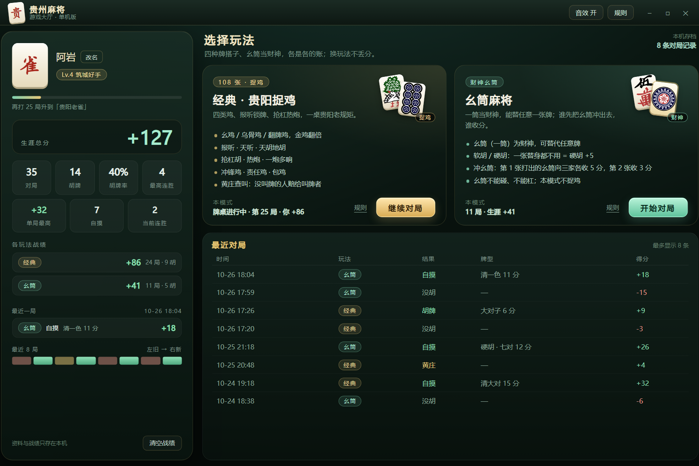

## 快速开始

```bash
cd guizhou-mahjong
npm install        # electron + ws 两个依赖
npm start          # 单机：或者双击 start.bat
npm run server     # 联机：启动服务器（默认 ws://0.0.0.0:8788）
```

- `start.bat` 是 GBK + CRLF 编码（中文 Windows 的 cmd 才能正确解析），会先清掉 `ELECTRON_RUN_AS_NODE` 再启动。
- 如果命令行里设过 `ELECTRON_RUN_AS_NODE=1`，直接 `electron .` 会被当成 Node 跑；`npm start` 走的 `scripts/launch.js` 会先删掉这个变量。
- 窗口 1320×880，可缩放（最小 1040×720），牌桌与大厅都按 1200×740 等比缩放适配。

## 游戏大厅

进游戏先到大厅（右上角「大厅」随时可以回来，牌桌会保着，再进去接着打）：

- **玩家资料**：头像（点一下换）、昵称（点「改名」直接改，回车保存）、段位（按对局数升，从「新手上路」到「黔中雀神」，下面一条进度和「再打 N 局升到……」）。
- **分数**：生涯总分（两个玩法之和），以及各玩法单独的分数、局数、胡牌数。
- **对局数据**：对局 / 胡牌 / 胡牌率 / 最高连胜，最近一局的牌型与得失，最近 12 局的走势小方块（绿胡、红没胡、金跳黄庄）。
- **玩法选择**：两张模式卡，写明玩法要点与本模式战绩；牌桌还没打完的会显示「继续对局 · 第 N 局 · 你 +X」。
- **最近对局**：时间、玩法、结果（自摸 / 胡牌 / 没胡 / 黄庄）、牌型与分值、得分，最多 8 条（本地存 60 条）。
- 「清空战绩」会清掉生涯战绩、对局记录和两个玩法的牌桌分数；牌桌上的「清空分数」只清当前玩法的四家分数。

数据都存在本机浏览器存储里：`gz-mj-profile-v2`（资料 / 战绩 / 记录）、`gz-mj-table-classic` 与 `gz-mj-table-yitong`（各自牌桌上四家的累计分、局数、庄家）。旧版本只存经典模式的 `gz-mj-score` 会在首次启动时自动迁移。

## 怎么玩

- **出牌**：轮到你时，点手牌里的任意一张就打出去（悬停会抬起）。
- **听牌提示**：叫牌后，手牌右侧会以**手牌样式**列出所听的每一种牌，角标是这种牌的**可见剩余张数**（最多列 4 种，其余显示 `+N`）；鼠标停在一张手牌上还会显示「打这张 → 听什么、可见还剩几张」，并把手牌里能胡的牌高亮（金边）。
- **碰 / 杠 / 胡**：别人打牌后如果可操作，底部会明确提示「谁打出哪张」，按钮也标出牌名；牌河里最新弃牌会高亮并标注「可碰这张」。提示不会自动消失，直到你选择操作或点「过」（`Esc` 也可以过）。
- **暗杠 / 补杠**：在自己回合、出牌之前，按钮出现在同一位置。别人补杠的那张正好是你听的牌时，会弹出「可以抢杠」和「抢杠胡」按钮。
- **报听**：轮到出牌且手牌听牌时，底部多一个「报听」按钮。点了之后系统替你打出保持听牌的那张，此后手牌锁定——不能碰、不能杠，摸什么打什么，见胡就胡，胡牌额外 +3；起手 13 张就听牌并在第一巡报听算**天听**（+6）。头像旁会挂「报听 / 天听」角标，桌心显示「报听中」。
- **自动摸打**：右上角「自动摸打 开 / 关」（也可以按 `A`）。开了之后，只要你已经听牌，摸牌后就会自动替你打出一张仍保持听牌的牌（优先打刚摸到的那张、听口剩张多的），能自摸就直接胡；没听牌时仍然弹提示让你自己打。碰 / 杠 / 胡（吃炮）始终由你点。
- **速度**：右上角「速度 慢 / 中 / 快」切换电脑出牌节奏。
- **庄家**：胡牌者接庄，黄庄庄家连庄。

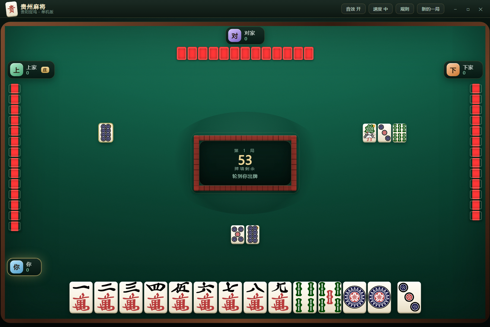

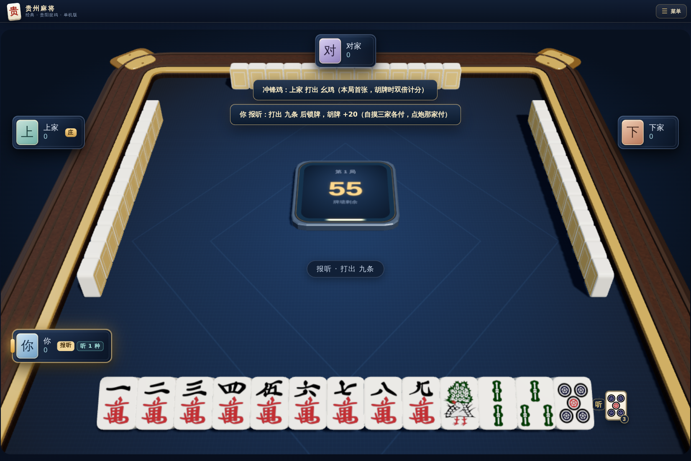

## 幺筒麻将

一筒就是**幺筒**，也是这桌的**财神**：

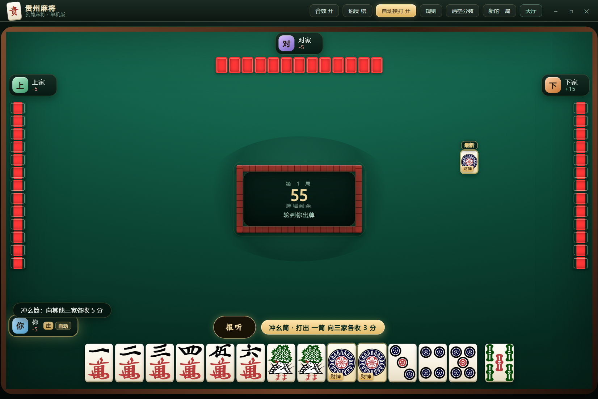

- **替牌**：手里每张幺筒都能替代任意一张牌去凑牌型——顺子缺张、刻子缺张、将缺一张都行；也可以当真一筒用（凑 123 筒、当刻子、当将），哪种划算按哪种算。
- **软胡 / 硬胡**：胡牌时用了替身就是**软胡**（牌型分照常）；一张替身都没用（幺筒全当真一筒，或者手里压根没幺筒）就是**硬胡**，胡牌分 **+5**。结算面板上会挂「硬胡 / 软胡」标签。
- **冲幺筒**：本局**第一张**被打出的幺筒，打牌者向其他三家**各收 5 分**；**第二张**各收 **3 分**；第三、第四张没有冲分。先冲先赚——冲出去就少一张财神，自己权衡。手里有幺筒时，底部会有一条金色提示「冲幺筒 · 打出 一筒 向三家各收 N 分」，鼠标悬停在那张幺筒上也会写。
- **不能碰、不能杠**：幺筒是财神，不成坎；手里四张也不弹暗杠。
- **没有鸡**：幺鸡、八筒在这里只是普通牌，不算鸡、不翻牌、没有包鸡。结算只看胡牌分 + 豆 + 冲幺筒。
- 牌型分值、自摸 / 杠上花、天胡地胡、报听天听、抢杠、热炮、一炮多响、豆、黄庄查叫、吃炮通行证都和经典一致。

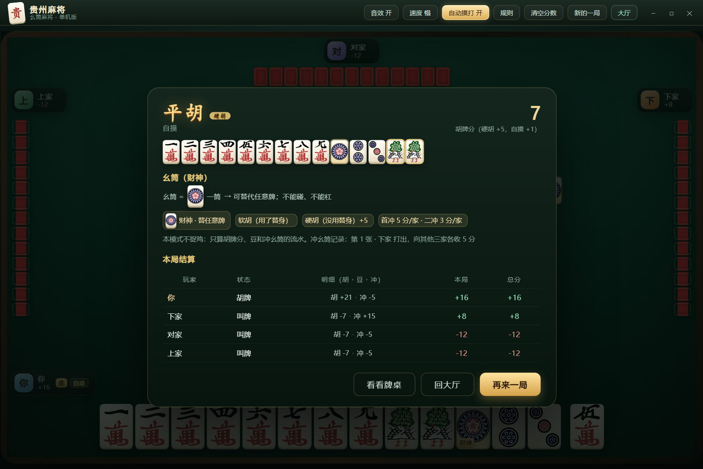

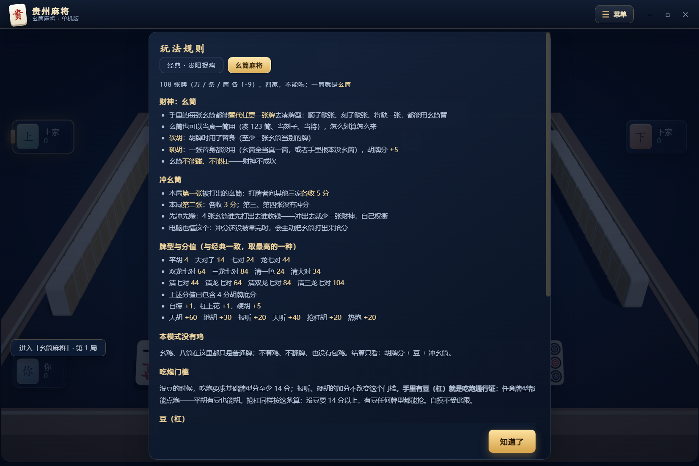

## 联机对战

一台机器当服务器，大家连同一个局域网就能开桌：

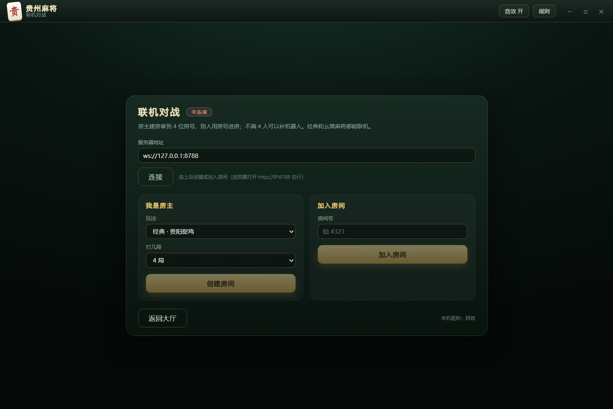

- **启动服务器**：`npm run server`（或 `node server/index.js --port=8788`）。启动后会把本机和局域网地址都打出来；同一个端口也是 HTTP 静态页，浏览器打开 `http://IP:8788` 就能玩，不用装任何东西。
- **建房**：大厅 → 联机对战 → 连接服务器 → 「创建房间」，选好玩法和局数，拿 4 位房号。
- **加入**：朋友在联机面板输入房号「加入房间」。看到座位列表、谁是谁、谁是房主。
- **机器人**：房主点「添加机器人」补空位（可移除）；对局中真人掉线，该座位自动转电脑代打，不坑局。
- **开局**：满员后房主点「开始对局」；每局打完结算面板点「再来一局」由房主开下一局，打到约定局数为止。
- **公平性**：服务端是权威端——`rules.js`/`game.js` 在 Node 里跑同一套规则；发牌、摸牌都在服务器，快照按座位轮转（你永远坐 0 号位），**别人的手牌和暗杠牌面不下发**；出牌 / 碰杠胡 / 报听 / 抢杠都是你自己在客户端点。
- **超时兜底**：出牌 60 秒、吃碰胡 20 秒没响应，服务器自动代打/放弃，不卡整桌。
- 联机对局也记入大厅的「最近对局」与生涯战绩（本机视角的得分），牌桌分数以服务器为准。

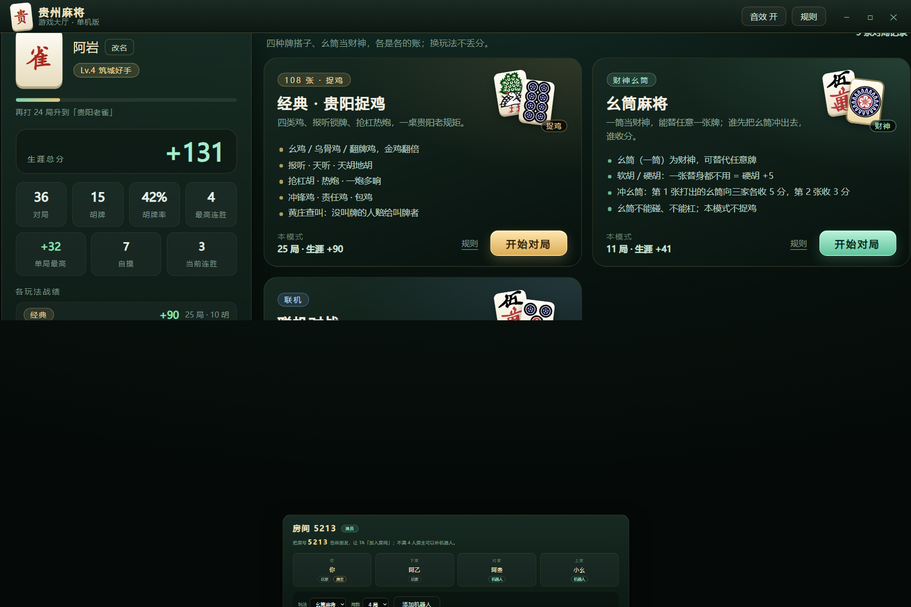

## 规则实现范围（经典 · 贵阳捉鸡）

| 项目 | 实现 |
| --- | --- |
| 牌张 | 108 张（万/条/筒 1-9，各 4 张），无字牌无花牌 |
| 操作 | 碰、明杠、暗杠、补杠、胡、报听、抢杠胡；不能吃 |
| 牌型 | 平胡 1、大对子 5、七对 7、龙七对 10、清一色 10、清大对 15、清七对 17、清龙七对 20（取最高，不叠加） |
| 附加 | 自摸 +1、杠上花 +1、**热炮 +1**；**天胡 +20**、**地胡 +10**；**报听 +3、天听 +6**、**抢杠胡 +5** |
| 吃炮通行证 | 有豆（杠过）平胡也能吃炮；没豆时只有 5 分以上牌型能吃炮，平胡只能自摸；抢杠胡不受限 |
| 豆（杠） | 每个 3 分：暗杠 / 补杠 三家各付，明杠只由放杠那家付，当场结算 |
| 报听 / 天听 | 报听锁牌（不能碰杠、摸什么打什么、见胡就胡）；起手听牌 + 第一巡报听 = 天听 |
| 天胡 / 地胡 | 天胡：庄家第一摸就自摸；地胡：下家第一巡自摸或胡庄家首张 |
| 抢杠胡 | 补杠的牌被别人胡 → 杠不成立，杠家包三家（赔三份） |
| 热炮 | 杠后打出的牌被别人胡，胡牌分 +1 |
| 一炮多响 | 一张牌被两家以上胡，所有人都算胡，点炮者各赔一份，鸡分别结算 |
| 鸡 | 幺鸡 1 分/张、乌骨鸡（八筒）2 分/张、翻牌鸡（翻牌的下一张）1 分/张；**金鸡**翻倍；**冲锋鸡**（本局第一张打出的幺鸡 / 八筒）双倍；**责任鸡**（冲锋鸡被碰 / 杠走）打者赔一个豆；**包鸡**（没叫牌的人）把自己的鸡赔给胡牌的人；叫牌者按「手牌 + 副露 + 自己牌河」向其他三家各收一份 |
| 黄庄 | 不翻牌，豆与鸡不算，查叫：未叫的人赔给每个叫牌者「其叫牌牌型的分值」 |
| 结算展示 | 牌型、胡牌分与各项加分、翻牌与鸡（含冲锋鸡 / 包鸡）、豆与责任鸡流水、四家本局与总分（恒为零和）；一炮多响逐家列出 |

规则口径参考了腾讯欢乐麻将的四类鸡说明（[鸡牌的种类](http://majiang.qq.com/webplat/info/news_version3/7207/31873/31888/35514/m18795/201803/703548.shtml)）、快懂百科「贵州麻将」提到的包牌 / 一炮两响三响 / 硬报软听（[baike.com](https://www.baike.com/wikiid/6072483849305906031)）、GitHub 上公开的贵阳捉鸡整理（[guiyang-zhuojimahjang](https://github.com/mobingchong/guiyang-zhuojimahjang)），以及遵义 / 凤冈幺筒麻将的公开说法（幺筒作替身、首冲幺筒、留手幺筒各有价，见[凤冈打幺筒麻将的计算方法](https://www.meipian.cn/5k7ababx)与快懂百科[遵义麻将](https://www.baike.com/wikiid/7542112393860672939)）。各地口径差别很大，本作把加分与赔率取成固定值并写进规则面板（`rules.js` 里的 `BONUS` / `CHONG_POINTS` 可直接改），保证一桌能算得清楚。

| 碰 / 杠 / 胡 | 结算 |
| --- | --- |
| 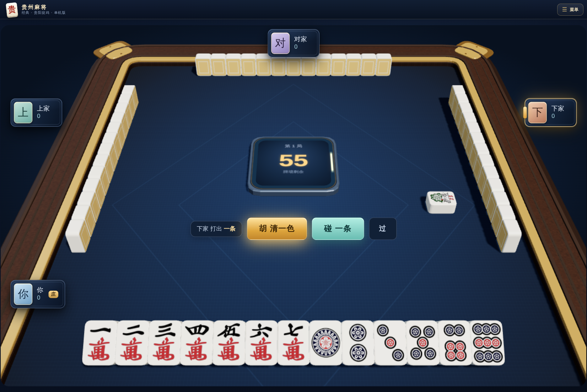 | 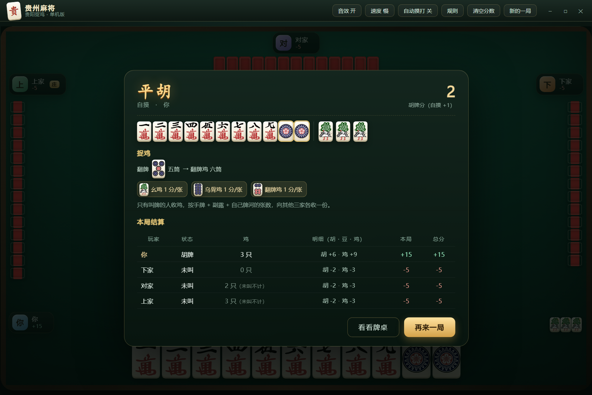 |

| 报听按钮 | 一炮多响 |
| --- | --- |
| 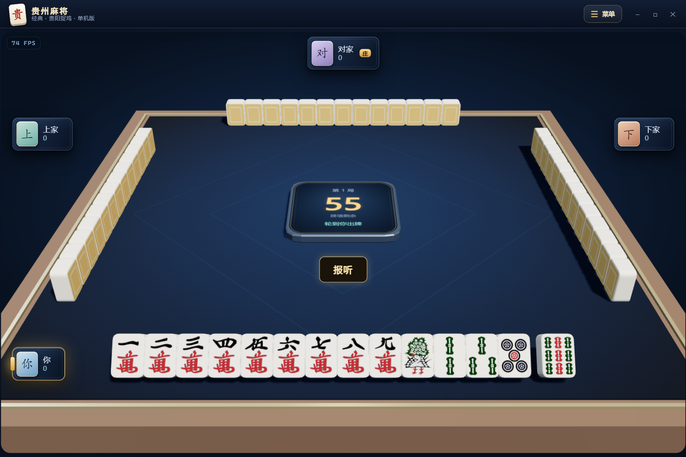 | 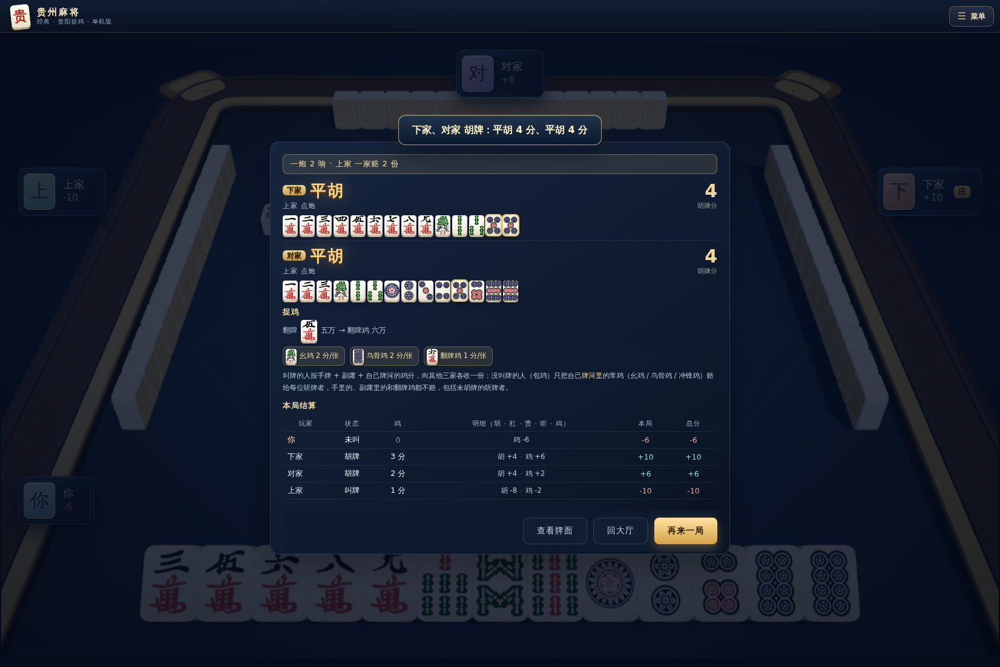 |

## 素材与许可

`src/assets/tiles/*.svg` 来自 [FluffyStuff/riichi-mahjong-tiles](https://github.com/FluffyStuff/riichi-mahjong-tiles)，作者声明为 **public domain（CC0）**，可商用、无需署名（这里仍标注来源）。该套图只含牌面花纹、透明底，牌身、阴影、牌背装饰由 `style.css` 绘制。

音效是 WebAudio 现场合成的（碰、杠、出牌、胡牌），不依赖任何音频文件。

## 代码结构

```
guizhou-mahjong/
├── electron/
│   ├── main.js         # 主进程：无边框窗口、窗口按钮 IPC、截图/自检模式
│   └── preload.js      # contextBridge 暴露最小窗口 API
├── scripts/
│   ├── launch.js       # 启动器（清 ELECTRON_RUN_AS_NODE）
│   ├── sim.cjs         # 随机对局压测（零和 / 异常检查，支持 --mode）
│   ├── e2e.cjs         # 联机协议端到端：真服务器 + WS 客户端打完整局
│   └── e2e-render.cjs  # 联机 UI 端到端：真服务器 + Electron 窗口点完一局
├── server/
│   ├── index.js        # HTTP 静态页 + WebSocket（同端口）、房间表、消息路由
│   ├── room.js         # 房间：座位 / 机器人 / 规则配置 / 局数 / 广播 / 掉线代打
│   ├── online-game.js  # OnlineGame：继承 game.js，按座位等待真人输入（多人碰杠胡 / 抢杠 / 超时兜底）
│   └── serialize.js    # 按座位轮转快照：你永远 0 号位，他人手牌与暗杠不下发
├── src/
│   ├── index.html
│   ├── preview.html    # 牌面预览（开发用）
│   ├── assets/tiles/   # CC0 牌面 SVG（Man/Sou/Pin 1-9 + Back）
│   ├── css/style.css   # 大厅、联机、牌桌、麻将牌、桌心牌墙、结算面板
│   └── js/
│       ├── rules.js    # 纯规则：玩法模式（MODES）、财神胡牌拆解、听牌、鸡与加分常量
│       ├── ai.js       # 电脑对手：牌效启发式 + 碰杠取舍 + 财神估值
│       ├── game.js     # 对局状态机：发牌、摸打、报听、抢杠、热炮、一炮多响、冲幺筒、结算
│       ├── tiles.js    # 牌 → SVG 文件映射
│       ├── profile.js  # 玩家资料 / 战绩 / 对局记录 / 各玩法牌桌分数（localStorage）
│       ├── net.js      # 联机网络层：WebSocket 连接、消息收发、断线通知
│       ├── remote-game.js # RemoteGame：把服务端快照包装成本地 Game 同款接口
│       ├── online.js   # 联机面板：连接 / 建房 / 加入 / 房间等待（机器人 / 规则 / 开局）
│       ├── lobby.js    # 游戏大厅：资料卡、玩法卡、联机入口、最近对局
│       └── ui.js       # 渲染、交互、音效、听牌提示、结算/规则弹层、联机特效回放
├── test/
│   ├── rules.test.cjs  # 34 个规则用例
│   └── online.test.cjs # 4 个联机用例（房间 / 快照 / 整局 / 操作校验）
└── start.bat
```

## 测试

```bash
npm test                                  # 38 个用例（规则 34 + 联机 4）
npm run sim                               # 200 局经典模式压测
node scripts/sim.cjs --mode=yitong --rounds=200   # 幺筒麻将压测
npm run e2e                               # 联机协议端到端（真实 WS 服务器打完一局）
npm run e2e:ui                            # 联机 UI 端到端（Electron 窗口点完一局）
```

38 个用例全部通过：

- 各牌型分值与「取最高不叠加」
- 副露参与判定、副露后不算七对
- 听牌张与查叫分值
- 吃炮通行证
- 庄家首轮只摸一次、手牌数为 14 张（防止庄家多摸一张导致胡牌判定失效）
- 鸡的分值（幺鸡 1 / 八筒 2）、金鸡翻倍、副露按张数计鸡
- 整局模拟 8 局：无异常、每局四家分数零和、黄庄数据结构完整
- 玩家侧动作路径：碰 / 杠 / 胡 的响应与结算
- 自动摸打：听牌时自动打刚摸的牌、保持听牌；能自摸直接胡；没听牌不接管；四局自动对局中「听牌时不该弹手动提示」
- 报听：锁牌、天听判定、出张；报听后整局不再要求手动出牌
- 报听 / 天听 / 天胡 / 热炮 / 抢杠的加分与包赔
- 天胡 / 地胡的判定条件
- 抢杠胡：杠不成立、杠家包三家（3 倍赔付）
- 热炮：杠后打出的牌被别人胡
- 一炮多响：一张牌两家胡、点炮者各赔一份
- 冲锋鸡双倍、责任鸡赔豆、包鸡反向赔付
- 含新规则的 6 局整局模拟：分数仍为零和
- 幺筒模式：一筒替牌能胡、经典模式不能；听牌多出一筒；硬胡 +5 进结算且本模式没有鸡
- 幺筒不能碰、不能杠（手里四张也不弹暗杠）
- 冲幺筒：首张向三家各收 5 分、第二张 3 分、第三张不收，且零和
- 玩法切换：两套规则各算各的（`MODES` / `CHICKEN_SET`）
- 联机：建房 / 加入 / 机器人 / 满员 / 房主转移；快照按座位轮转（人人 0 号位）且不下发他人手牌与暗杠；两真人+两机器人连打两局零和；非法操作（别人的回合、不存在的牌、乱胡）全被拒

压测结果（各 200 局，四家总分恒为零和、无异常）：

| 模式 | 结局 | 报听 | 冲幺筒 | 硬胡 / 软胡 | 抢杠 · 热炮 · 一炮多响 |
| --- | --- | --- | --- | --- | --- |
| 经典 | 176 胡 / 24 黄庄 | 27 | — | — | 2 · 0 · 0 |
| 幺筒麻将 | 199 胡 / 1 黄庄 | 45 | 326 次 | 65 / 136 | 2 · 1 · 2 |

联机端到端：`npm run e2e`（协议级，1 房主 + 1 玩家 + 2 机器人打满约定局数）与 `npm run e2e:ui`（Electron 真窗口点完一局）都通过；UI 级验证含结算面板弹出、四家零和、快照持续到达。

## 开发自检

```bash
npm run shot            # 桌面对局截图 → output/table.png
npm run shot:preview    # 牌面预览 → output/tiles.png
npm run sim             # 200 局随机对局压测：异常与零和检查
```

`electron/main.js` 里的 `--shot-mode=lobby|table|claim|result|rules|tip|ting|auto|baoting|baoting-on|multi|yitong|yitong-result|yitong-rules|online|online-room|online-e2e` 可以分别截取对应界面，便于回归检查样式。

## 后续可以做的

- 打包成 exe（接 `electron-builder`，现在只跑源码）
- 让电脑也会报听 / 抢杠时更保守的取舍
- 第三种玩法（比如只打筒条两门的「缺一门」），模式表已经预留：在 `rules.js` 的 `MODES` 里加一项即可，联机房间会自动出现在下拉里
- 联机进阶：断线重连回座位（现在掉线转机器人代打）、观战位、房号外的房间列表
- 更多皮肤：换一套牌背 / 桌布
