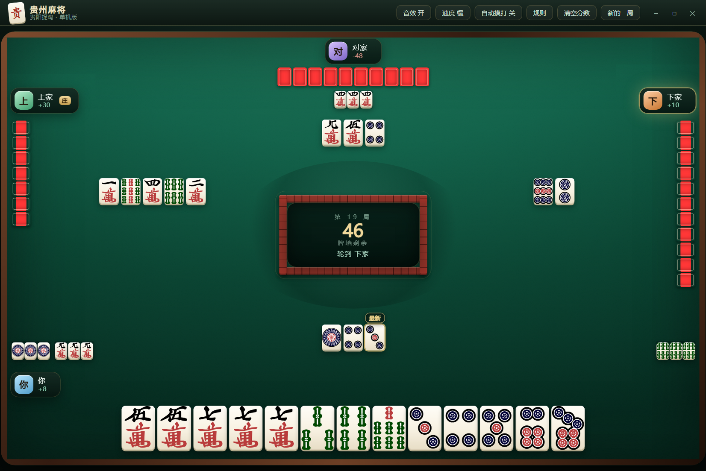
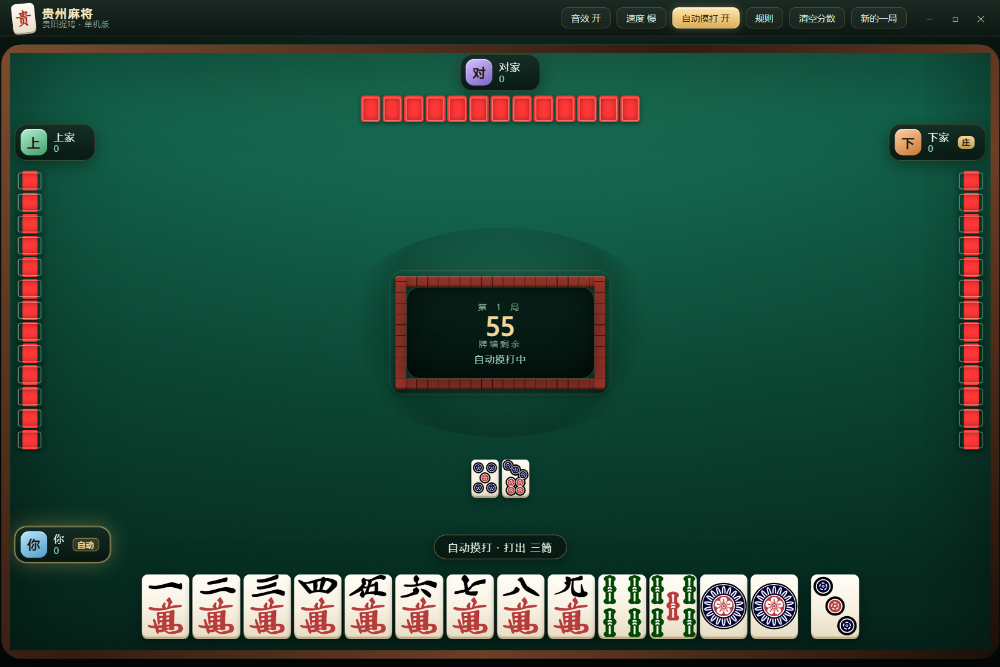

# 贵州麻将 · 贵阳捉鸡（Electron 桌面版）

一个能真正坐下来打的贵州麻将单机版：108 张牌、三家电脑对手、碰 / 杠 / 胡、捉鸡算分、豆（杠）分、黄庄查叫，全部按贵阳捉鸡的口径实现。

牌面用的是公共领域的整套麻将矢量图（见下方「素材与许可」），界面为原生 HTML/CSS/JS，没有用游戏引擎。



## 快速开始

```bash
cd guizhou-mahjong
npm install        # 只装 electron 一个依赖
npm start          # 或者双击 start.bat
```

- `start.bat` 是 GBK + CRLF 编码（中文 Windows 的 cmd 才能正确解析），会先清掉 `ELECTRON_RUN_AS_NODE` 再启动。
- 如果命令行里设过 `ELECTRON_RUN_AS_NODE=1`，直接 `electron .` 会被当成 Node 跑；`npm start` 走的 `scripts/launch.js` 会先删掉这个变量。
- 窗口 1320×880，可缩放（最小 1040×720），牌桌按 1200×740 等比缩放适配。

## 怎么玩

- **出牌**：轮到你时，点手牌里的任意一张就打出去（悬停会抬起）。
- **听牌提示**：叫牌后，手牌右侧会以**手牌样式**列出所听的每一种牌，角标是这种牌的**可见剩余张数**（最多列 4 种，其余显示 `+N`）；鼠标停在一张手牌上还会显示「打这张 → 听什么、可见还剩几张」，并把手牌里能胡的牌高亮（金边）。
- **碰 / 杠 / 胡**：别人打牌后如果可操作，底部会明确提示「谁打出哪张」，按钮也标出牌名；牌河里最新弃牌会高亮并标注「可碰这张」。提示不会自动消失，直到你选择操作或点「过」（`Esc` 也可以过）。
- **暗杠 / 补杠**：在自己回合、出牌之前，按钮出现在同一位置。
- **自动摸打**：右上角「自动摸打 开 / 关」（也可以按 `A`）。开了之后，只要你已经听牌，摸牌后就会自动替你打出一张仍保持听牌的牌（优先打刚摸到的那张、听口剩张多的），能自摸就直接胡；没听牌时仍然弹提示让你自己打。碰 / 杠 / 胡（吃炮）始终由你点。开关状态保存在本地，下一局、下次启动都记得。
- **速度**：右上角「速度 慢 / 中 / 快」切换电脑出牌节奏（默认「慢」，约 1.4 秒一手；嫌慢可以调快）。
- **分数保存**：四家累计分数、局数和庄家会保存在本地，退出重开后恢复；点「清空分数」并确认，可将四家累计分数归零。
- **庄家**：胡牌者接庄，黄庄庄家连庄。




## 规则实现范围

| 项目 | 实现 |
| --- | --- |
| 牌张 | 108 张（万/条/筒 1-9，各 4 张），无字牌无花牌 |
| 操作 | 碰、明杠、暗杠、补杠、胡；不能吃 |
| 牌型 | 平胡 1、大对子 5、七对 7、龙七对 10、清一色 10、清大对 15、清七对 17、清龙七对 20（取最高，不叠加） |
| 附加 | 自摸 +1、杠上花 +1 |
| 吃炮通行证 | 有豆（杠过）平胡也能吃炮；没豆时只有 5 分以上牌型能吃炮，平胡只能自摸 |
| 豆（杠） | 每个 3 分：暗杠 / 补杠 三家各付，明杠只由放杠那家付，当场结算 |
| 鸡 | 幺鸡（一条）、乌骨鸡（八筒）、翻牌鸡（翻牌的下一张）；金鸡翻倍；只有叫牌（听牌）的人按「手牌 + 副露 + 自己牌河」的张数向其他三家各收一份 |
| 黄庄 | 不翻牌，豆与鸡不算，查叫：未叫的人赔给每个叫牌者「其叫牌牌型的分值」 |
| 结算展示 | 牌型、胡牌分、翻牌与鸡、豆的流水、四家本局与总分（恒为零和） |

**未实现**（规则面板里也写了）：报听 / 天听、天胡地胡、抢杠胡、热炮、一炮多响、冲锋鸡、责任鸡、包鸡。规则口径参考了 GitHub 上公开的贵阳捉鸡整理（[guiyang-zhuojimahjang](https://github.com/mobingchong/guiyang-zhuojimahjang)）与通行玩法资料，取舍以保证单机一桌能顺畅打完为准。

| 碰 / 杠 / 胡 | 结算 |
| --- | --- |
|  |  |

## 素材与许可

`src/assets/tiles/*.svg` 来自 [FluffyStuff/riichi-mahjong-tiles](https://github.com/FluffyStuff/riichi-mahjong-tiles)，作者声明为 **public domain（CC0）**，可商用、无需署名（这里仍标注来源）。该套图只含牌面花纹、透明底，牌身、阴影、牌背装饰由 `style.css` 绘制。

音效是 WebAudio 现场合成的（碰、杠、出牌、胡牌），不依赖任何音频文件。

## 代码结构

```
guizhou-mahjong/
├── electron/
│   ├── main.js         # 主进程：无边框窗口、窗口按钮 IPC、截图/自检模式
│   └── preload.js      # contextBridge 暴露最小窗口 API
├── scripts/launch.js   # 启动器（清 ELECTRON_RUN_AS_NODE）
├── src/
│   ├── index.html
│   ├── preview.html    # 牌面预览（开发用）
│   ├── assets/tiles/   # CC0 牌面 SVG（Man/Sou/Pin 1-9 + Back）
│   ├── css/style.css   # 牌桌、麻将牌、桌心牌墙、结算面板
│   └── js/
│       ├── rules.js    # 纯规则：牌型拆解、听牌、鸡、分值（浏览器/Node 通用）
│       ├── ai.js       # 电脑对手：牌效启发式 + 碰杠取舍
│       ├── game.js     # 对局状态机：发牌、摸打、抢牌优先级、杠分、结算
│       ├── tiles.js    # 牌 → SVG 文件映射
│       └── ui.js       # 渲染、交互、音效、听牌提示、结算/规则弹层
├── test/rules.test.cjs # 17 个用例
└── start.bat
```

## 测试

```bash
npm test
```

17 个用例全部通过：

- 各牌型分值与「取最高不叠加」
- 副露参与判定、副露后不算七对
- 听牌张与查叫分值
- 吃炮通行证
- 庄家首轮只摸一次、手牌数为 14 张（防止庄家多摸一张导致胡牌判定失效）
- 鸡的三种类型、金鸡翻倍、副露按张数计鸡
- 整局模拟 8 局：无异常、每局四家分数零和、黄庄数据结构完整
- 玩家侧动作路径：碰 / 杠 / 胡 的响应与结算
- 自动摸打：听牌时自动打刚摸的牌、保持听牌；能自摸直接胡；没听牌不接管；四局自动对局中「听牌时不该弹手动提示」

## 开发自检

```bash
npm run shot            # 桌面对局截图 → output/table.png
npm run shot:preview    # 牌面预览 → output/tiles.png
```

`electron/main.js` 里的 `--shot-mode=claim|result|tip|ting|auto|rules` 可以分别截取对应界面，便于回归检查样式。

## 后续可以做的

- 打包成 exe（接 `electron-builder`，现在只跑源码）
- 报听、抢杠胡、热炮、一炮多响
- 联机（把 `game.js` 的状态机搬到服务端，前端只做 view）
- 更多皮肤：换一套牌背 / 桌布
